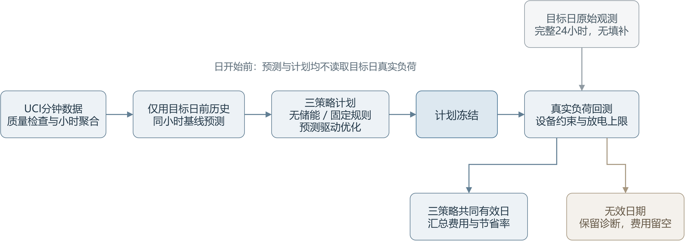
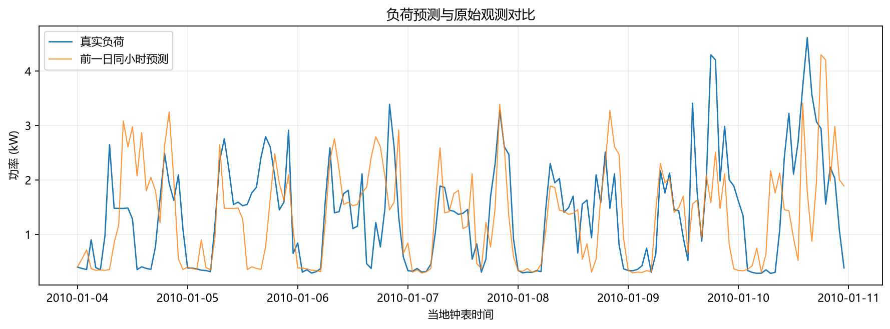
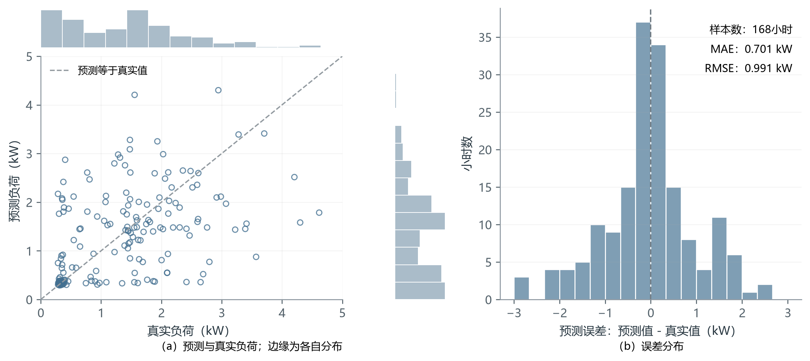
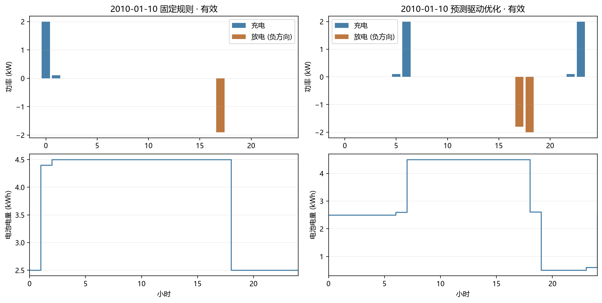

# 用电负荷预测与储能调度优化

项目报告 · v0.1 · 2026-10-20

## 1. 项目概况

本项目尝试回答：已知历史家庭用电记录和分时电价，怎样安排次日的电池充放电，才能减少购电费用？程序先预测24小时负荷，再求解调度计划，最后用目标日原始观测检查计划能否执行。



图1 处理流程。目标日真实负荷只用于计划冻结后的评价。

## 2. 已实现内容

程序通过Python命令行读取TOML配置，检查分钟数据后聚合到小时，生成预测和三策略计划，再导出费用、图表和失败诊断。每次运行保存数据哈希、配置和环境版本，便于复现。数据、预测、优化与回测分别封装，前一日同小时预测作为首版基线。



图2 测试期小时预测与原始观测，数据来自同一户家庭。

# 数据与优化模型

## 3. 数据与预测

数据来自UCI Individual Household Electric Power Consumption，使用分钟级Global_active_power，单位kW。测试期为2010-01-04至2010-01-10，是2010年内首个连同前一日均有完整原始观测的连续七日区间；选期只检查观测完整性。来源、下载时间和SHA-256随实验保存。

历史输入最多前向填补连续缺失5分钟；冲突时间戳作为缺失断点。每小时有60个有效分钟后取功率均值，小时电量为该值乘1小时。正式评价要求目标日24小时各有60个原始有效观测，不使用填补值代替真实值。

目标日D的第h小时，采用D-1日同小时负荷预测。误差按全部有效小时计算；预测误差与费用比较的样本集合分别记录。

L_pred(D,h) = L(D-1,h),  h = 0,...,23

MAE = (1/N) Σ |L_pred - L_actual|

RMSE = √[(1/N) Σ (L_pred - L_actual)²]

## 4. 储能调度模型

一天分为24段，t=0,...,23，Δt=1 h。c、d为充、放电功率，g为购电功率（kW）；E为电池电量（kWh），π为电价（元/kWh），z∈{0,1}表示充放电模式。目标是最小化预测购电费用：

min Σ π_t g_t Δt

g_t = L_pred,t + c_t - d_t ≥ 0;   d_t ≤ L_pred,t

0 ≤ c_t ≤ P_c,max z_t;   0 ≤ d_t ≤ P_d,max (1-z_t)

E_(t+1) = E_t + η_c c_t Δt - d_t Δt / η_d

E_min ≤ E_t ≤ E_max;   E_0 = E_24 = E_initial

默认电池容量5 kWh，电量范围0.5至4.5 kWh，初末电量2.5 kWh，充放电功率上限各2 kW，效率各0.95。假设电价为：00-06时0.30、07-16时及22-23时0.60、17-21时1.00元/kWh。两项均为实验设定。

PuLP建模，CBC单线程求解，单日时限30秒。程序核对求解状态、最优性日志并重算约束。无储能和预先设定的固定规则作为对照；各日独立，两种储能策略使用相同设备及初末电量条件。

回测固定c、d，并以真实负荷重新计算购电量。若放电超过真实负荷，该日策略不可执行，费用留空，保留违反时刻和幅度。

# 真实数据实验与结果解释

## 5. 预测误差与调度可执行性

| 评价项目 | 默认实验结果 |
| --- | --- |
| 预测测试范围 | 2010-01-04 至 2010-01-10，共7日、168小时 |
| 预测 MAE / RMSE | 0.701245 / 0.991260 kW |
| 三策略费用共同有效日 | 2010-01-05、2010-01-10 |
| 费用比较覆盖率 | 2/7 = 28.57% |



图3 168小时预测诊断。左为预测与真实负荷，右为预测误差分布。

七日优化均在预测条件下求得最优解，但其中五日放电超过真实负荷，回测不可执行；固定规则有三日不可执行。这些属于回测失败。程序保留原计划和诊断，不截断放电，也不把空费用当作0元。放电时段预测偏高可能使计划超过真实负荷，全天平均误差不能代替可执行性检查。

## 6. 共同有效两日的购电费用

| 策略 | 实际购电费用（元） | 相对无储能节省率 |
| --- | --- | --- |
| 无储能 | 53.861140 | 0.0000% |
| 固定规则 | 51.324298 | 4.7100% |
| 优化策略 | 50.050614 | 7.0747% |

优化策略在两日合计减少购电费用3.810526元，节省率7.0747%。这两个日期按事后回测可执行性筛选，所得是有效日期上的条件比较，不能推算全周收益。

## 7. 结论与局限

本次实验说明，预测条件下最优的计划仍可能无法执行。当前预测基线和两日有效费用样本不足以支持普遍节费结论。下一步可检验更多时段、滚动调度和预测不确定性约束；模型尚未计入设备投资、老化和需量费用。

# 参数情景与复现

## 8. 调度案例与电池参数对照



图4 2010-01-10的充放电与电量轨迹，该日三策略均可执行。

另一情景将容量、电量上限、初始电量改为3.0、2.5、1.5 kWh，其余不变。两组共有的三策略有效日期仅2010-01-10；该日优化费用从26.558437元变为27.511068元。可用能量缩小限制了低价电转移，但因三项参数同时变化，这不是单因素容量敏感性分析。两组有效日期不同，也不能直接比较各自总费用。

## 9. 验证与复现

已在Windows、Python 3.12.10、CBC 2.10.3环境通过90项pytest测试。测试涉及单位换算、数据缺失、时间对齐、未来信息隔离、已知最优解、设备约束和失败汇总；依赖由uv.lock锁定。

在02_项目源码目录执行下列命令。下载约133 MB的公开原始数据后，分析过程可离线运行；已有结果可直接阅读。

```powershell
uv sync --locked
uv run load-storage doctor
uv run load-storage download-data
uv run load-storage run --config configs/example.toml
uv run pytest
```

参数对照使用configs/capacity3.toml。默认实验导出全部结果后返回退出码1，表示存在五日回测失败。详细原因见cost_comparison.csv和diagnostics.json。

## 10. 数据与结果来源

[UCI：Individual Household Electric Power Consumption（数据主页）](https://archive.ics.uci.edu/dataset/235/individual+household+electric+power+consumption)

两次实验的CSV、JSON、图表和CBC日志完整保存在03_实验结果。原始运行的配置、数据哈希、代码版本和环境信息见metadata.json。
